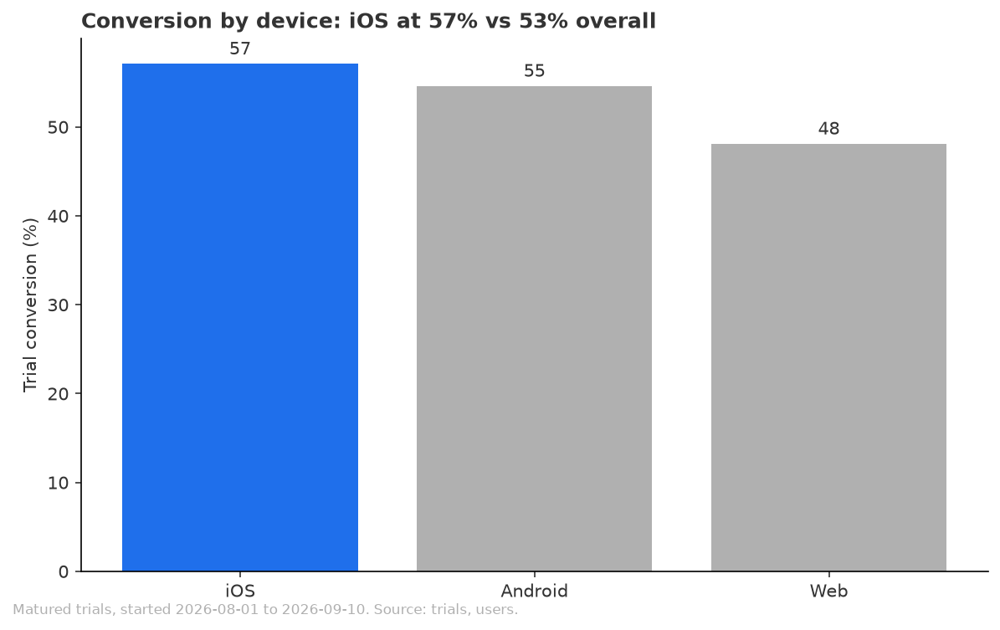
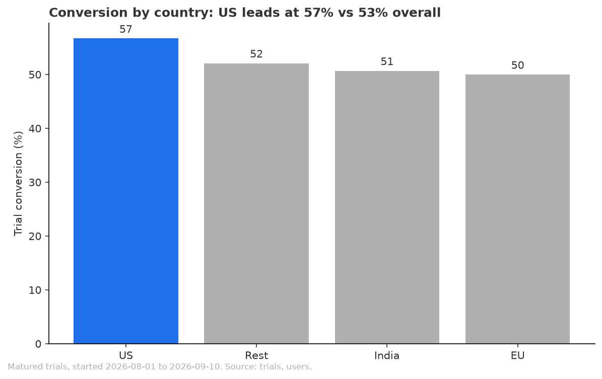
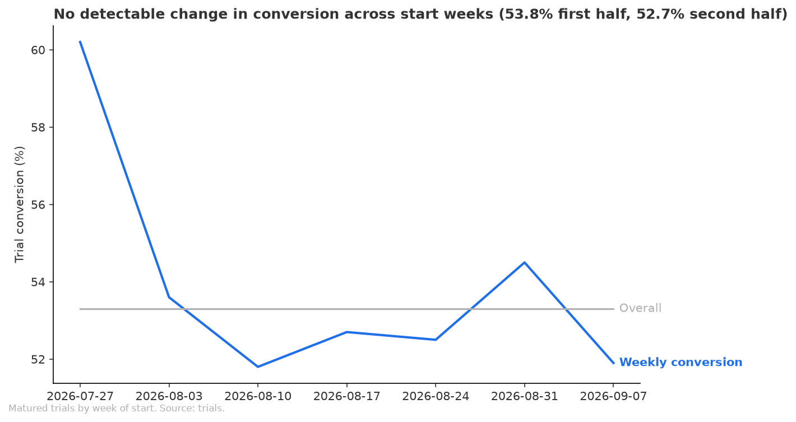

# Mobile users convert best from trial to paid, and conversion has not moved since trials launched

## Recommendation
Weight next quarter's acquisition budget toward mobile sign-ups, iOS first, and away from web sign-ups: web trials convert at 48.1% against 57.1% for iOS and 53.3% overall. Do not change the budget because of the trend, since conversion shows no detectable change since trials launched on 2026-08-01. You did not name a threshold for how big a gap should move budget, so this is a call on direction, not size. It looks only at trial conversion, not at what each audience costs to acquire or how long it stays.

## Key Takeaways
- Web trial users convert at 48.1% of trials, 5.2 percentage points below the 53.3% overall rate, while iOS users convert at 57.1% (3.8 points above overall) and Android at 54.6% (1.2 points above).
- The device gap is unlikely to be chance, and web is the lowest device in all four country groups (for example 51.9% vs 60.3% for iOS in the US, and 44.4% vs 56.1% in India).
- US users convert at 56.7%, 3.4 percentage points above the 53.3% overall rate, but EU (50.0%), India (50.7%) and Rest (52.1%) are not clearly different from each other, so country is a lean, not a finding.
- Conversion shows no detectable change over time: 53.8% for trials started 2026-08-01 to 2026-08-21 and 52.7% for 2026-08-22 to 2026-09-10, a drop of 1.1 percentage points (2.0% relative), within normal week-to-week noise.
- Only about seven weeks of trial history exist, and trials started after 2026-09-10 are not finished yet, so "no change" means no change so far, not a long-run trend.

## Evidence
**Device is the clearest signal.** Of 1,553 finished trials, 828 converted (53.3%). iOS 57.1% (518 trials), Android 54.6% (526), Web 48.1% (509) [data/conversion_by_device.csv, finished trials only, analysis.py segments step]. A test for whether the three devices differ scores 8.87 against a cutoff of 5.99, so the gap is unlikely to be chance. iOS vs Web scores 2.89 and Android vs Web 2.07 against a cutoff of 1.96 [data/significance.csv, analysis.py significance step].

**Web is lowest everywhere.** Web converts below iOS in every country: US 51.9% vs 60.3%, EU 45.2% vs 57.0%, Rest 46.7% vs 52.2%, India 44.4% vs 56.1% [data/conversion_by_country_device.csv, analysis.py country by device step]. Each cell holds 90 to 216 trials, so read the pattern, not any single cell.

**Country is a weaker signal.** US 56.7% (638 trials, 5.8 percentage points above all other countries combined), Rest 52.1%, India 50.7%, EU 50.0% [data/conversion_by_country.csv]. The test for whether the four countries differ scores 5.38 against a cutoff of 7.81, so the differences could be chance. US against the other three scores 2.26 against 1.96, but that comparison was picked after seeing the data, and US against EU alone scores 1.95 [data/significance.csv].

**No detectable trend.** First half 53.8% (823 trials), second half 52.7% (730 trials), a change of -1.1 percentage points, or -2.0% relative; the test scores -0.43 against a cutoff of 1.96 [data/trend_first_vs_second_half.csv, data/significance.csv, analysis.py trend step]. Weekly rates run from 51.8% to 60.2%; the 60.2% is the first partial week (88 trials, plausible range 49.8% to 69.8%), so single weeks are too noisy to read [data/conversion_by_start_week.csv]. The country mix of trials did not shift between halves (US 41.1% in both) [data/country_mix_by_half.csv].

**One thing to watch.** iOS goes from 59.6% in the first half to 54.4% in the second (-5.2 percentage points), while Web (+1.5) and Android (+0.3) do not fall [data/trend_by_segment.csv]. With 270 and 248 trials that gap is within noise, so it is not a trend yet.

## How this was measured
Conversion is converted trials divided by trials that ended in a conversion or a cancellation. It counts only trials whose 14 days had closed by 2026-09-24, which means trials started 2026-08-01 to 2026-09-10; open trials are not counted as failures. "Kinds of users" means country and device type, because the data holds no acquisition channel. Each segment is compared with the 53.3% overall rate and with the rest, in percentage points; the trend compares the first and second half of the window. These match the frame. Every trial starts on the user's signup day, so how long someone has had an account cannot split users.

## Checks
The review recomputed the overall, device and country rates and the August and September rates by a second route and they agreed. The join to users kept every trial, segment counts add back to the total, and the result tables are the same on a second run. Verdict: Think on it.

Not verified:
- The iOS drop between halves is within noise (z 1.19 against 1.96, computed in the review, not in the script).
- The US lead is a contrast chosen after seeing the data.
- Whether "converted" always means a paid subscription exists was not matched against subscriptions.
- 520 trials whose window had not closed by 2026-09-24 are excluded, so trials started after 2026-09-10 are unread. Counting all resolved trials gives 50.0% instead of 53.3%, because early cancellers resolve first.
- Acquisition cost, channel and value after conversion are not in the data.
- The definitions marked "(assumed)" in the frame were not confirmed.
