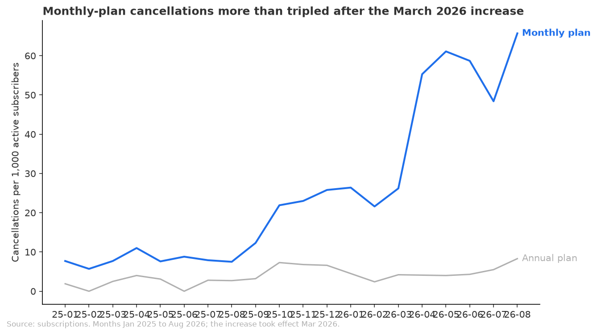
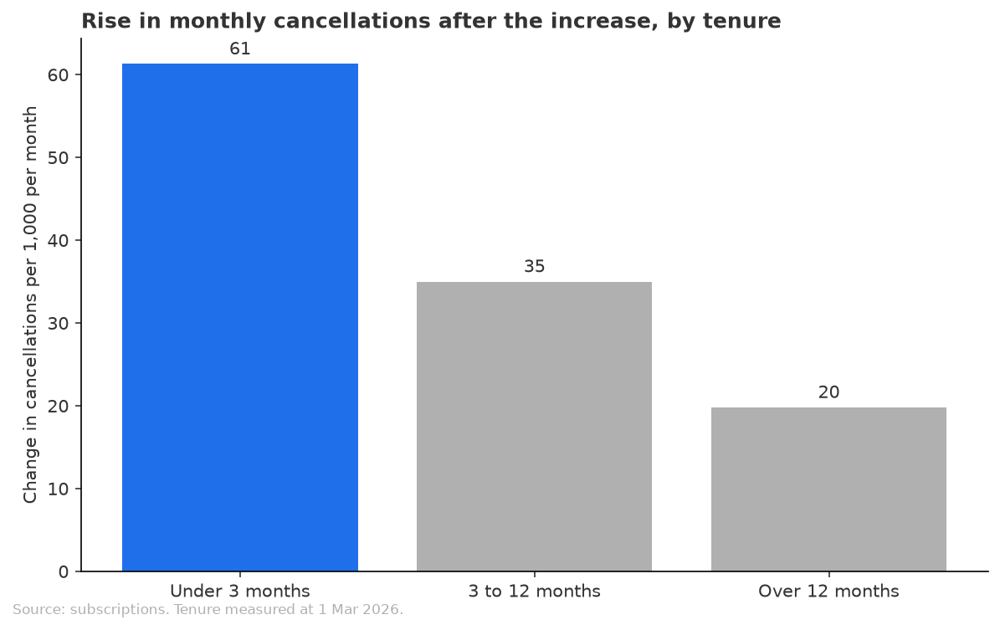
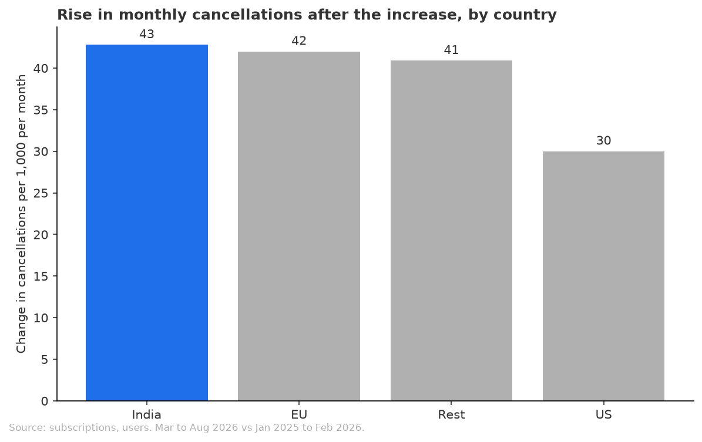

# Monthly cancellations more than doubled after the March 2026 price increase, hitting newer subscribers hardest

## Recommendation
Monthly-plan cancellations went from about 24 to about 53 per 1,000 subscribers a month once the price moved from $10 to $12, so a partial rollback is worth considering. If you roll back, target subscribers in their first year (especially those under 3 months), where the rise is largest, not a country or device, where every group rose. Because everyone on the monthly plan got the increase, run the rollback as a test against a group left at $12 before making it permanent. No threshold for acting was given, so this is a reading of the size of the rise, not a pass against a bar.

## Key Takeaways
- Monthly-plan cancellations rose from 23.7 to 52.5 per 1,000 subscribers a month (+28.8 per 1,000, +122% relative) when comparing March to August 2026 with October 2025 to February 2026.
- Annual-plan cancellations, which did not face this price change, moved only from 3.7 to 5.1 per 1,000 a month (+1.4 per 1,000), so the rise is specific to the monthly plan.
- Subscribers with under 3 months on the plan at the increase rose most (14.2 to 75.5 per 1,000, +61.3 per 1,000), then 3 to 12 months (31.1 to 66.1, +35.0), then over 12 months (9.7 to 29.5, +19.8).
- Every country and device rose; US (+30.0 per 1,000) and iOS (+26.8) rose least, while India (+42.8), EU (+42.0), Rest (+40.9) and Web (+44.6) rose most.
- The jump shows up in April 2026 (55.3 per 1,000), not March (26.2, the same as the 26.4 of January), and it has stayed above 48 through August.

## Evidence
**Overall.** Against the quieter period from October 2025 to February 2026 the monthly rate was 23.7 per 1,000 and after the increase 52.5 [data/before_after_summary.csv, monthly plan, closed months, analysis.py section 1]. Against all of January 2025 to February 2026 (15.5) the rise looks even larger (+37.0 per 1,000, +239% relative), but that earlier window includes the quiet months of early 2025 (8.0 per 1,000), so the closer window is the fairer comparison.

**Annual plans.** 3.7 before and 5.1 after [data/before_after_summary.csv, annual plan]. The annual plan is a different product with few cancellations, so it is a rough guide only.

**Who.** By tenure at 1 March 2026 [data/change_by_tenure.csv, analysis.py section 3]:

By country [data/change_by_country.csv]:

Device figures are in [data/change_by_device.csv]: Web 18.8 to 63.4, Android 14.7 to 55.9, iOS 13.2 to 40.0 per 1,000. Country and tenure together are in [data/change_by_country_and_tenure.csv].

**Timing.** March 2026 was 26.2 per 1,000, April 55.3, May 61.1, June 58.7, July 48.4 and August 65.7 [data/monthly_churn_by_month.csv].

**The September 2025 sign-up spike.** Those subscribers cancel more than others, but they are not the explanation: they rose from 39.3 to 78.3 per 1,000 and everyone else from 13.0 to 48.0 [data/september_2025_cohort_split.csv].

## How this was measured
The measure is monthly cancellations per 1,000 subscribers who were active at the start of the month, for paid monthly plans only. This differs from the share still subscribed at a fixed age that was first assumed, because a calendar-month rate lines up directly with the date of the price change. Free plans are excluded, subscriptions starting after 2026-09-24 are excluded, and a cancellation scheduled after 2026-09-24 counts as still active. September 2026 is still open, so the last month used is August 2026. The comparison is the same plan before and after the increase, plus annual plans as a rough control. Every monthly subscriber moved to $12 on 2026-03-01, including existing ones. Tenure groups are set at 1 March 2026.

## Checks
A second calculation by a different route gave 15.4 before and 53.1 after, in line with 15.5 and 52.5. Rerunning gave identical tables, groups add back to the total of 1,697 cancellations, and payments confirm $10 before March and $12 from March. Verdict: Think on it, meaning the numbers hold but the reading has limits.

Not verified:
- Cause. Every monthly subscriber got the increase at once, so the rise cannot be separated from anything else that changed around then. The April timing and the flat annual plan fit a price effect but do not prove one.
- Why people cancelled. The data holds no reasons.
- New subscribers since March, who have only ever paid $12, cancel at 100.5 per 1,000, but there is no earlier group to compare them with. Monthly starts also spiked in July to September 2026 for reasons not confirmed.
- No threshold for acting was given.
- Country by tenure groups have small counts in several cells, so read them as direction only.
- September 2026 is open and not counted.
