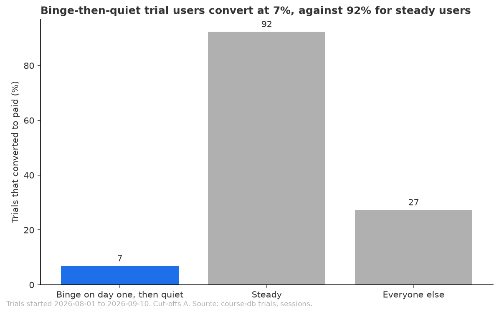
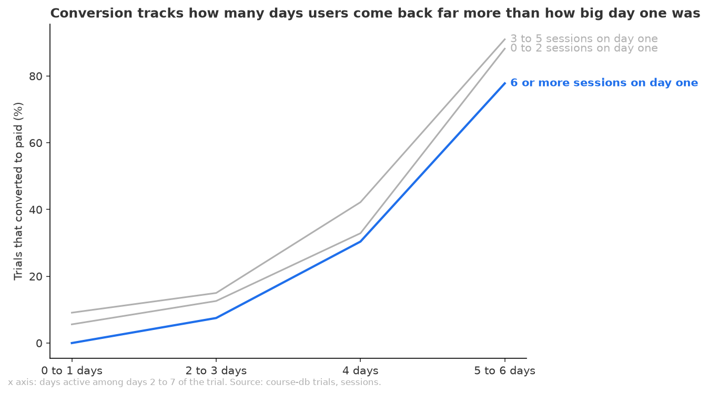

# Trial users who binge on day one and then go quiet almost never convert, but going quiet is the real problem

## Recommendation
Trial users who come back on most days of their first week convert at 86.1%, and those who come back on one day or none convert at 5.7%, so test onboarding emails that bring users back on days two to seven. An email aimed only at spreading out day-one use is less supported: among users who go quiet, a heavy day one is only a little worse than a light one (6.9% against 10.2%). The data cannot show that an email moves users from one pattern to the other, so run it as a test, with some trial users getting the new emails and others not, before changing every email. Your bar was any clear conversion gap, and the gap here is far larger than the differences between comparable groups of users, so the bar is met.

## Key Takeaways
- Trial users who binge on day one and then go quiet convert at 6.9% (4 of 58 trials), against 92.3% for steady users (670 of 726), a gap of 85.4 percentage points (93% lower, relative).
- With a second, looser set of definitions the result barely moves: 8.8% (8 of 91) against 92.9% (613 of 660), a gap of 84.1 percentage points.
- Going quiet is what separates the groups: conversion rises from 5.7% for users active on 0 to 1 of days two to seven, to 11.9% for 2 to 3 days, 34.7% for 4 days and 86.1% for 5 to 6 days.
- Among users who go quiet, a heavy day one adds little: 6.9% (4 of 58) with six or more sessions on day one against 10.2% (22 of 215) with two or fewer, a difference of 3.3 percentage points that 58 trials cannot separate from chance.
- Among users who stay active on 5 to 6 days, a heavy day one is lower: 77.8% (266 trials) with six or more sessions on day one against 88.2% (246 trials) with two or fewer, 10.4 percentage points lower.

## Evidence
**Binge-then-quiet against steady.** At the main definitions, binge-then-quiet users converted at 6.9%, steady users at 92.3% and everyone else at 27.3% (154 of 565) [data/conversion_by_group.csv, cut-offs A, matured trials with a full first week, analysis.py headline section]. The range of plausible values for the binge-then-quiet rate is 2.7% to 16.4%, because the group is small. Compared with everyone else, binge-then-quiet users are 20.4 percentage points lower. At the looser definitions the three rates are 8.8%, 92.9% and 34.6% [data/conversion_by_group.csv, cut-offs B].

**The gap holds in every split.** Binge-then-quiet minus steady, by device: -79.4 to -89.4 percentage points; by country: -77.2 to -91.0; by start week: -62.3 to -94.5 [data/gap_by_segment.csv, cut-offs A]. Steady users' own conversion varies by 9.7 points across device and country (86.1% to 95.8%), so the gap is far larger than the differences between comparable groups. Some splits have fewer than 10 binge-then-quiet trials (one country and three start weeks), so single-split figures are rough.

**What drives it.** Conversion by the number of days a user came back on days two to seven, and by how heavy day one was [data/conversion_by_day_one_and_later_days.csv, analysis.py binge-versus-quiet section]:

At every level of later activity, users with six or more sessions on day one convert somewhat less than users with fewer: 0.0% against 5.6% for 0 to 1 days (5 and 72 trials), 7.5% against 12.6% for 2 to 3 days, 30.4% against 32.9% for 4 days and 77.8% against 88.2% for 5 to 6 days. The cells with only a handful of trials (for example the 5 trials at 0 to 1 days) are not reliable on their own.

**Who was counted.** 1,553 trials started by 2026-09-10 have a final outcome. 204 of them were cancelled in the first 7 days and are set aside, because a user who has already left cannot show a first-week pattern. That leaves 1,349 trials, of which 828 converted [data/raw_population.csv].

## How this was measured
Conversion is the share of trials that became a paid plan when the 14-day trial ended. The population is trials started between 2026-08-01 and 2026-09-10, so every outcome is final by 2026-09-24, and trials that ended in the first 7 days are set aside. Behaviour is measured over the first 7 days from each trial's start date; day one is the start date because session dates carry no time of day. Binge-then-quiet means six or more sessions on day one and activity on 3 or fewer of days two to seven (main definition), or at least 40% of the week's sessions on day one with four or more sessions and activity on 3 or fewer of the later days (looser definition). Steady means activity on 5 or more of the later days with day one under 30% (main) or 25% (looser) of the week's sessions. Everyone else is the reference group. These cut-offs were set from how first-week activity is spread across all trials, before looking at conversion. Two things were added: the looser set of definitions, as a check, and the table of day-one size against later activity, after the first result, to separate bingeing from going quiet. Trials began on 2026-08-01, so the data holds about seven weeks of trials. Sessions are a very large table and were only queried as aggregates.

## Checks
A second calculation by a different route matched the saved figures exactly for the device split at the main definitions and the start-week split at the looser definitions. Rerunning gave identical tables, the groups add back to the 1,349 trials in every split and in both sets of definitions, the join of trials to sessions did not duplicate any trial, and only trials with a final outcome were used. Verdict: Think on it, meaning the numbers hold but the reading has limits.

Not verified:
- Whether an email would change what users do. There is no email data, and the figures show which patterns go with converting, not that a nudge moves a user between them.
- Whether going quiet is a cause or a symptom. Users who have already decided to cancel may go quiet because of it. The 204 trials cancelled in the first week are not in the comparison, and none of them converted.
- The binge-then-quiet group is small (58 trials at the main definitions, 91 at the looser ones), and steady users convert at close to the ceiling, partly because being active most days goes with converting. Treat single-split gaps with fewer than 10 binge-then-quiet trials as rough.
- Day one is the start date, so a trial that starts late in the day has only part of a day one. Trials were not split by start time.
- Binge and quiet were defined by sessions and days active only; minutes listened were not used.
- Groups were not crossed with each other (for example device by country).
- Part of the result tables were copied by hand from query output. Two full splits were matched to the database; not every cell was.
- August 2026 session counts run about 20% higher a day than July and this was not explained; whether trial users account for it was not checked.
- The definitions of the groups, the first week, the cut-offs and "clear gap" (larger than the spread between comparable groups) were chosen by the analyst and have not been confirmed.
