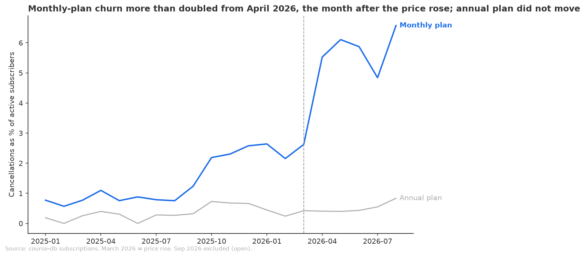
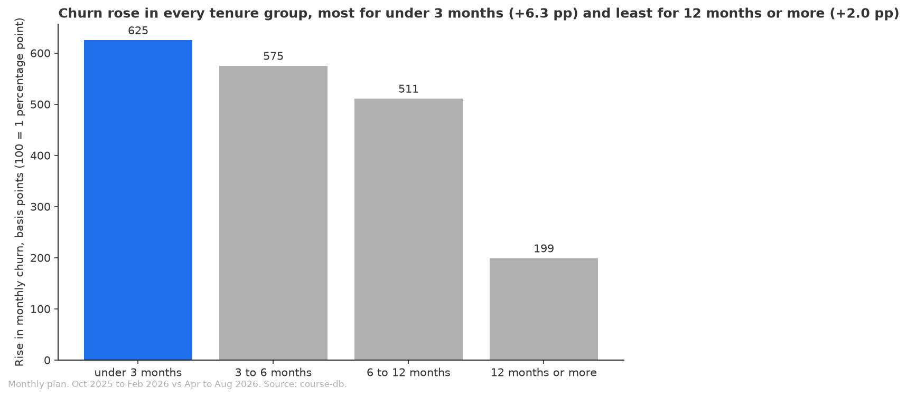
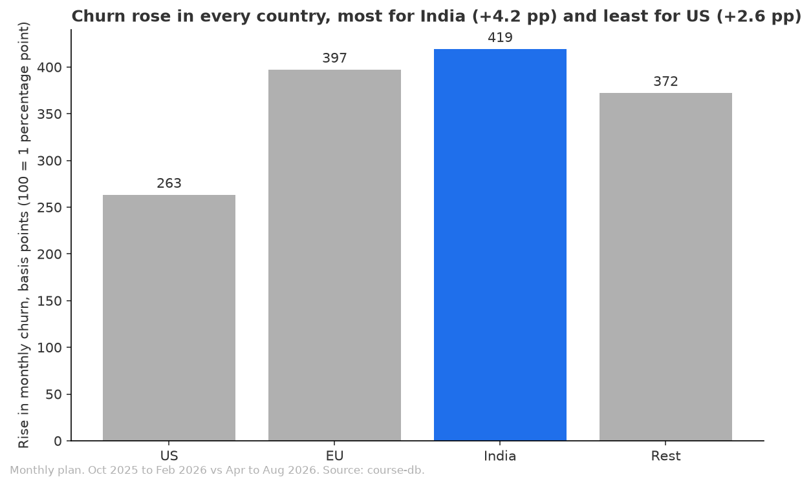
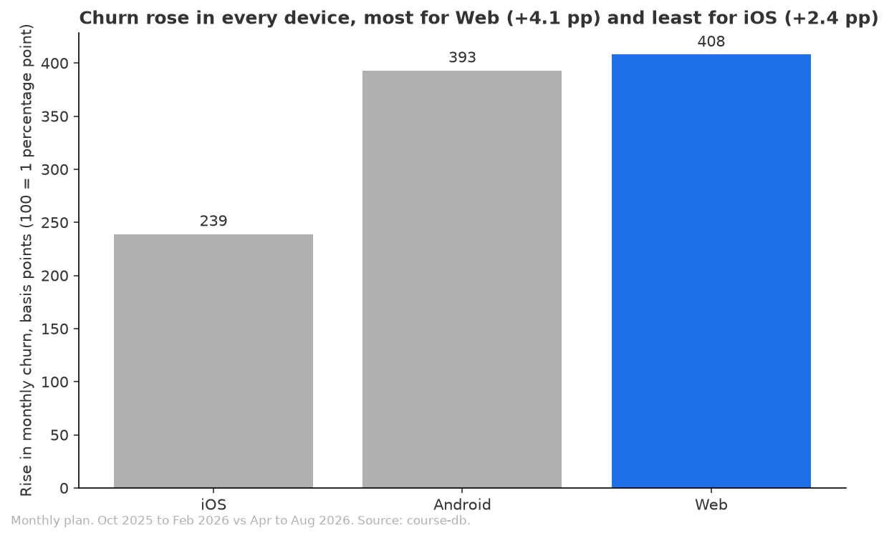

# Monthly-plan cancellations more than doubled after the March 2026 price increase, and newer subscribers left the most

## Recommendation
About 917 more monthly subscribers cancelled between April and August 2026 than the earlier rate would have produced (1,553 against 636), so a partial rollback is worth testing. If you roll back, start with subscribers in their first year, where cancellations rose most (under 3 months: 3.36% to 9.61% a month), rather than with a country or device, because every country and device rose. The data shows cancellations rose after the price did, not that the price caused it, so run the rollback as a test against a group left at $12 before making it permanent. Every group rose clearly, so the bar you set (any clear drop for a segment) does not pick out who to roll back; that choice rests on size of rise and revenue, which this work did not weigh.

## Key Takeaways
- Monthly-plan cancellations rose from 2.37% to 5.79% of active subscribers a month (+3.42 percentage points, +144% relative) when comparing April to August 2026 with October 2025 to February 2026.
- The rise began in April, not March: March 2026 was 2.62%, in line with the 2.16% to 2.64% of the five months before, and April was 5.53%.
- Annual-plan cancellations, which did not face this price change, stayed flat at 0.55% a month before and 0.53% after.
- Newer subscribers rose most: those with under 3 months on the plan went from 3.36% to 9.61% a month (+6.25 percentage points), against 1.21% to 3.19% (+1.99 percentage points) for those with 12 months or more.
- Every country and device rose; the US (+2.63 percentage points) and iOS (+2.39) rose least, while India (+4.19), Web (+4.08), EU (+3.97), Android (+3.93) and Rest (+3.72) rose most.

## Evidence
**Overall.** Before the increase (October 2025 to February 2026) 2.37% of active monthly subscribers cancelled each month; after it (April to August 2026) 5.79% did [data/monthly_churn_by_month.csv, monthly plan, closed months, analysis.py headline section]. Every month after the increase (lowest 4.84%) is above every month in the five before it (highest 2.64%). Against all of January 2025 to February 2026 (1.55% a month) the rise is larger, +4.24 percentage points, but those early months were unusually quiet, so the closer window is the fairer comparison [analysis.py output]. That adds up to about 917 extra cancellations over the five months [analysis.py output, rate before applied to April to August subscribers].

**Timing.** March was 2.62%, then April 5.53%, May 6.11%, June 5.87%, July 4.84% and August 6.57% [data/monthly_churn_by_month.csv]. Cancellations may lag a price change by about a month; this was not tested. Cancellations also stepped up once before, from 0.75% in August 2025 to 2.19% in October 2025, with no price change, and stayed at 2.16% to 2.64% until the increase.

**Annual plans.** 0.55% before and 0.53% after [data/monthly_churn_by_month.csv, annual plan]. Annual plans are a different product with few cancellations, so this is a rough guide, not a control group.

**Who: tenure.** Subscribers are grouped by how long they had been on the plan at the start of each month [data/segment_churn_change.csv, tenure rows, analysis.py segment section]. Under 3 months: 3.36% to 9.61% (+6.25 percentage points). 3 to 6 months: 3.50% to 9.25% (+5.75). 6 to 12 months: 3.40% to 8.51% (+5.11). 12 months or more: 1.21% to 3.19% (+1.99).

**Who: country.** US 2.24% to 4.88% (+2.63 percentage points), EU 2.20% to 6.17% (+3.97), India 2.42% to 6.62% (+4.19), Rest 2.75% to 6.47% (+3.72) [data/segment_churn_change.csv, country rows].

**Who: device.** iOS 2.00% to 4.39% (+2.39 percentage points), Android 2.27% to 6.20% (+3.93), Web 2.88% to 6.96% (+4.08) [data/segment_churn_change.csv, device rows].

## How this was measured
The measure is the share of paid monthly subscribers active on the first day of a month who cancelled during that month. The comparison is the same plan before and after the increase: October 2025 to February 2026 against April to August 2026, with March 2026 shown on its own because the price rose that month. Free plans are excluded, subscriptions starting after 2026-09-24 are excluded, and a cancellation scheduled after 2026-09-24 counts as still active. September 2026 is still open, so the last month used is August 2026. Every monthly payment from 2026-03-01 is $12 and every one before is $10, so all monthly subscribers moved together and no group stayed at $10. Two things differ from what was first planned: the measure is a calendar-month cancellation rate, not the share still subscribed a set number of days after joining, because it covers existing subscribers and lines up with the date of the price change; and the earlier period is the five months before the increase, not the whole of 2025, because early 2025 was unusually quiet. The September 2025 signup spike (about five times a normal month) sits inside the before period's subscriber base.

## Checks
A second calculation by a different route matched the headline rates exactly (2.37% before, 5.79% after), and totals for each country and each device matched the database. Rerunning gave identical tables, the country, device and tenure groups each add back to the overall total in every month, joining payments to subscriptions did not duplicate rows, and the open month was excluded. Verdict: Think on it, meaning the numbers hold but the reading has limits.

Not verified:
- Whether the price caused the rise. No monthly group stayed at $10, and cancellations stepped up once before without a price change, in October 2025.
- Whether the tenure and country gaps are partly a start-month effect. Subscribers who joined in the September 2025 spike were 7 to 11 months old during the after period and sit in the 3 to 12 month groups, which account for 131 and 353 of the 917 extra cancellations (3 to 6 months and 6 to 12 months). No cut by start month was run.
- Country, device and tenure were not combined, so a gap shown for one may come from another.
- The share of subscribers still subscribed a set number of days after joining was not measured.
- Why subscribers left; the data holds no reasons.
- Part of the saved result tables were copied by hand from query output. Totals and one country cut and one device cut were checked against the database, not every cell.
- The definitions of the measure, the groups, the periods and "clear drop" (a rise above the usual month-to-month range) were chosen by the analyst and have not been confirmed.
